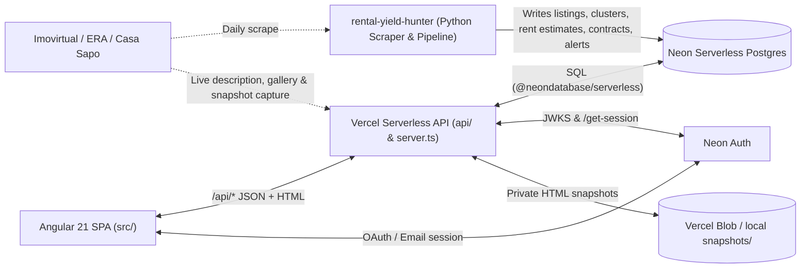

# System Architecture & Domain Guide

This document explains how `rental-yield-hunter-ui` fits into the broader ecosystem, its core real-estate domain calculations, and the data flows between the Angular SPA, serverless API, external property portals, and Neon Postgres.

---

## 1. Ecosystem Overview

### Two-Repository Split

- **`rental-yield-hunter` (companion Python backend)**: Owns all database migrations, scrapes property portals (`imovirtual`, `era`, `casasapo`), tracks price changes, computes market rental estimates (`rental_estimates`), extracts tenanted contract details (`rent_contract_details`), clusters duplicate multi-agency ads (`listing_clusters`), and sends deal notifications (`alert_notifications`).
- **`rental-yield-hunter-ui` (this repository)**: Owns the Angular 21 web interface, the TypeScript API layer (`api/` + `server.ts`), user-specific state mutations (`user_favorites`, `user_hidden`, `saved_searches`), admin overrides/manual listings (`listings`, `rent_contract_details`, `audit_log`), live portal description/image hydration, and HTML page snapshot capture/viewing.

---

## 2. Core Domain Concepts

### 2.1 Buy vs. Rent Modes

The dashboard (`DashboardComponent`) operates in two route-driven modes:

- **Buy Mode (`/buy`)**: Queries `listings` joined with `rental_estimates`, `rent_contract_details`, `listing_clusters`, `user_favorites`, and `user_hidden`. Managed by `FilterStateService`.
- **Rent Mode (`/rent`)**: Queries `rental_listings` joined with `user_favorites`. Managed by `RentalFilterStateService`. Serves both to browse the rental market directly and to inspect the comparables powering buy-side yield estimates.

### 2.2 Market Rent Estimates & Gross Yield

For vacant (or uncontracted) buy listings, the Python pipeline populates `rental_estimates` using a non-linear size-curved model (`area^0.30`) matched against comparable `rental_listings`:

- `estimated_rent`: Estimated monthly market rent in EUR.
- `rental_yield`: Gross annualised market yield (`(estimated_rent * 12) / price`), stored as a decimal (e.g. `0.0625` = `6.25%`).
- `avg_rent_per_m2`, `sample_count`: Comparable statistics.
- `confidence`: `'high' | 'medium' | 'low' | 'none'`.
- `match_level`: `'neighborhood' | 'city' | 'neighborhood_broad' | 'city_broad' | 'none'`.

### 2.3 Tenanted Listings, Lifetime Rent & Reversion Upside

Buy listings can be tenanted (`is_rented = true`), either under:

1. **Lifetime / Old-Regime Rent (`lifetime_rent = true`)**: Indefinite/protected leases where market reversion is unavailable. Highlighted with a red `Lifetime` badge.
2. **Fixed-Term Lease (`is_rented = true`, `lifetime_rent = false`)**: Tracked in `rent_contract_details` (populated either by NLP extraction in the Python pipeline or manually via the admin **Mark as Rented** dialog):
   - `current_rent` (`rent_current_rent`): Actual monthly rent paid under the active lease.
   - `contract_expiry_date` (`rent_contract_expiry`) & `months_to_expiry` (`rent_months_to_expiry`): Lease end date and remaining months. Leases expiring within **180 days** display an amber `Expiring soon` badge on the detail page.
   - `current_yield` (`rent_current_yield`): `(current_rent * 12) / price`.
   - `reversion_yield` (`rent_reversion_yield`): `(estimated_rent * 12) / price` once the lease reverts to market rent.
   - `rent_upside_pct`: `(estimated_rent - current_rent) / current_rent`.
   - `confidence`, `raw_rent_text`, `raw_expiry_text`: NLP extraction provenance shown on the detail card.

**Effective Display & Sort Yield**:
Both the UI (`displayYield()` in `ListingsTableComponent` and `DetailComponent`) and SQL sorting (`sort=rental_yield` in `api/listings/index.ts`) prioritise **actual contract yield** over estimated market yield whenever `is_rented = true AND lifetime_rent = false AND current_rent IS NOT NULL`.

### 2.4 Multi-Agency & Cross-Source Apartment Clustering

The same physical property in Portugal is frequently listed simultaneously by multiple agencies or across Imovirtual, ERA, and Casa Sapo at different prices.

- `listing_clusters` links each `listing_id` to a `cluster_id` with precomputed `cluster_size`, `cluster_min_price`, `cluster_max_price`, `price_spread`, `price_spread_pct`, `is_cheapest`, and `sources` (`cluster_sources`).
- **Table badges**: Listings with `cluster_size > 1` show `N ads` (or `-€<spread> · N ads` in green when `is_cheapest && price_spread > 0`).
- **Deduplication toggle (`deduplicate=true`)**: Filters `GET /api/listings` to show only unclustered listings plus the single lowest-priced active non-deleted listing per `cluster_id` (`ORDER BY l2.price ASC, l2.id ASC LIMIT 1`).
- **Detail view ("Also Listed On")**: `GET /api/listings/:id` queries active non-deleted sibling rows in the same `cluster_id` (`cluster_siblings`) and renders price deltas (`−€X cheaper` / `+€X`) with direct internal and external links.

### 2.5 Price History & Single-Cut Drop Reconstruction

Price changes are tracked in two places:

1. Summary columns on `listings` / `rental_listings`: `initial_price`, `price_drop_amount`, `price_drop_pct`, `price_change_count`.
2. Time-series rows in `listing_price_history` / `rental_listing_price_history`: `(price, previous_price, captured_at)`.

**Important nuance**: When a listing was scraped before full initial-row logging or only has a history row recorded at the moment of its first price cut, `rawPriceHistory[0].price` already reflects the _new_ price. Both `api/listings/[id].ts` and `api/rental-listings/[id].ts` prepend `{ price: initial_price ?? rawPriceHistory[0].previous_price, captured_at: first_seen }` when `initPrice !== rawPriceHistory[0].price` so single-cut price drops plot as a two-point downward slope in `PriceChartComponent`. Similarly, `api/listings/index.ts` computes `previous_price` via `PREV_PRICE_SQL` (falling back to `initial_price`) so table `▼ X%` badges and `price_drop_pct` sorting work for both single-cut and multi-cut listings.

---

## 3. Live Portal Hydration (`/api/listings/description` & `api/_lib/portals.ts`)

Database rows store baseline scraped text and `raw_data` JSON thumbnails, which may be truncated or stale. When opening either `DetailComponent` or `RentalDetailComponent` for a supported portal URL (`isPortalHydrationSupported(url)`), the UI calls `GET /api/listings/description?url=...` (CDN-cached for 1h via `s-maxage=3600, stale-while-revalidate=86400`), backed by `api/_lib/portals.ts`:

- **Imovirtual (`imovirtual.com`)**: Extracts the `/pt/anuncio/<slug>` slug, fetches and caches Next.js `buildId` (10-min in-memory TTL), requests `/_next/data/<buildId>/pt/anuncio/<slug>.json`, retries with a fresh `buildId` on miss, and falls back to parsing `<script id="__NEXT_DATA__">` from the HTML page.
- **ERA (`era.pt`)**: Extracts the numeric property reference from `-<digits>` at the end of the URL, fetches the listing HTML to scrape `__RequestVerificationToken` and session `Set-Cookie` headers, then calls `https://www.era.pt/API/ServicesModule/Property/PropertyDetailByReference?reference=<ref>` (excluding floor plans where `IsPlan === true`).
- **Casa Sapo (`casa.sapo.pt`)**: Fetches the HTML page, extracts `detail-description-text` / `property-description`, and rewrites `media.casasapo.pt` image URLs to `/Z1440x1080/` (`large`) and `/Z720x540/` (`medium`).

---

## 4. Offline Page Snapshots

Listings frequently disappear from portals once sold or leased. Snapshots preserve the full ad for due diligence:

- **Triggering**: Automatically fired in the background when a user favourites a buy or rental listing, or manually triggered from the detail toolbar (`POST /api/listings/snapshot?id=<id>[&source=rental]`).
- **Production (`process.env['VERCEL']` truthy)**:
  - Runs `playwright-core` with `@sparticuz/chromium-min` (`maxDuration: 300` seconds in `vercel.json`).
  - Spoofs navigator properties to reduce bot walls (throws explicit error if CloudFront/403 block is detected) and clicks `"Mostrar mais"` if present.
  - Intercepts network responses, inlines CSS and fonts as base64 `data:` URIs, strips `<script>`/`<noscript>`/`<laq-survey-root>` elements, fetches high-resolution gallery images, and injects a self-contained keyboard-navigable lightbox (`#__lb`) before `</body>`.
  - Uploads `snapshots/<id>.html` to **private** Vercel Blob, upserts `listing_snapshots (listing_id, blob_url)`, and serves the HTML inline through `/api/listings/snapshot-download?id=<id>` (authenticated server-side with `BLOB_READ_WRITE_TOKEN`).
- **Local Development (`process.env['VERCEL']` falsy)**:
  - Invokes `node_modules/.bin/single-file` CLI (`single-file-cli`) to save `snapshots/<id>.html` on disk without writing to Vercel Blob or `listing_snapshots`.
  - Served both at `GET /api/snapshots/:id` (`server.ts`) and via local disk fallback inside `GET /api/listings/snapshot-download?id=<id>`, so `SnapshotViewerComponent` works seamlessly in local dev and Vercel production alike.

---

## 5. Saved Searches & Alert Badges

- Users can save their active Buy or Rent filter state as a named preset (`SavedSearchesComponent`).
- Stored in `saved_searches` (`filters` JSONB mirrors `FilterQueryParams` / `RentalFilterQueryParams` plus `mode: 'buy' | 'rent'`).
- On `GET /api/hidden?resource=saved-searches`, `api/_lib/saved-searches.ts` dynamically counts for each **Buy** search (Rent searches return `0`/`0`):
  - `new_matches`: Active non-deleted matching listings with `first_seen > last_checked_at`.
  - `price_drops`: Active non-deleted matching listings with a `listing_price_history` drop captured after `last_checked_at`.
- Clicking a saved search chip applies its filters and calls `POST /api/hidden?resource=saved-searches&id=<id>` to advance `last_checked_at = NOW()`, clearing the unread badges.
